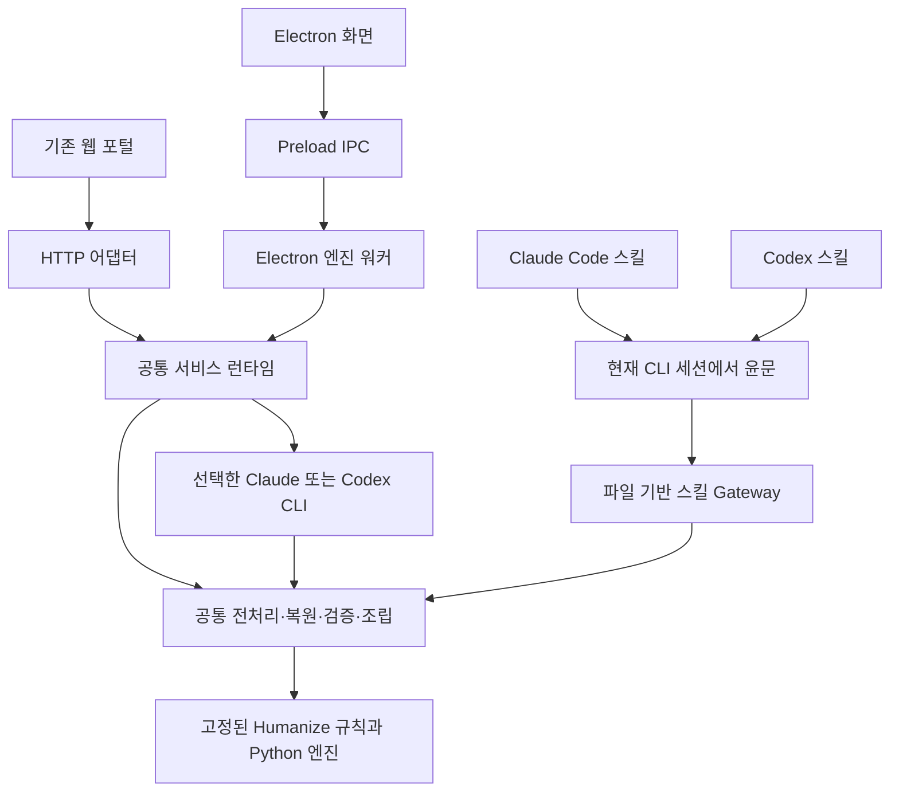

# Claude·Codex 스킬 및 Electron Windows 실행 앱 구현 계획

작성일: 2026-09-07

기준 코드: `42e6ff6`

상태: v0.2.0 구현·배포물 빌드 완료. 실제 사용법은 [앱 안내](../desktop.md), 검증 범위는 [릴리스 기록](../releases/0.2.0.md)을 참고한다. 아래는 구현의 기준이 된 계획이다.

## 1. 확정 요구사항과 배포 결과

기존 한국어 윤문 엔진을 사용자가 자신의 PC와 Claude Code·Codex에서 사용할 수 있게 확장한다. Windows 앱의 AI 실행은 **PC에 이미 설치·로그인된 Claude CLI 또는 Codex CLI를 사용하며, 사용자가 둘 중 하나를 선택한다.** 한쪽만 설치·로그인되어 있어도 해당 엔진으로 사용할 수 있어야 한다.

| 제공 형태 | 사용 방법 | AI 실행 위치 | 필요한 조건 |
|---|---|---|---|
| Claude Code 스킬 | `/humanize-kr`로 글 또는 파일 윤문 요청 | 현재 Claude Code 세션 | 사용자 PC의 Claude Code 설치·로그인 |
| Codex 스킬 | `$humanize-kr`로 글 또는 파일 윤문 요청 | 현재 Codex 세션 | 사용자 PC의 Codex 설치·로그인 |
| Windows 앱 | `HumanizeKR-<version>-win-x64.exe` 더블클릭 후 Claude/Codex 선택 | 선택한 로컬 CLI의 자식 프로세스 | 선택한 CLI 설치·로그인, AI 호출을 위한 인터넷 연결 |
| 기존 LAN 포털 | 기존 `npm.cmd start` 경로 유지 | 기존 서버 PC의 선택된 CLI | 기존 운영 환경 |

Windows 앱은 Electron과 Python 런타임을 포함한 portable EXE 한 개로 배포한다. 앱을 사용하기 위해 별도로 Node.js·Python을 설치하거나 서버를 실행할 필요가 없게 한다. Claude/Codex CLI의 설치·인증은 사용자의 기존 환경을 이용한다.

Electron Builder의 `portable` 타깃은 설치 없이 실행하는 Windows EXE를 생성한다. 내부 리소스는 실행 시 임시 폴더에 풀릴 수 있다. 사용자가 받는 배포물은 EXE 한 개이며, 내부적으로 파일을 전혀 생성하지 않는 프로그램이라는 의미는 아니다. [Windows 타깃 문서](https://www.electron.build/docs/win/), [portable 임시 추출 설정](https://www.electron.build/docs/api/app-builder-lib.interface.portableoptions/)

초기 Windows 지원 대상은 Windows 10/11 x64로 정한다. 기존 웹 포털은 별도 실행 경로로 유지하되, 새 앱과 스킬은 포털 실행·동일 와이파이·방화벽 개방에 의존하지 않는다. API 키 직접 연결, 자체 AI 로그인 구현, CLI 자동 설치·업데이트, Windows 설치 마법사, 자동 시작 등록, macOS/Linux 데스크톱 앱은 이번 범위에 넣지 않는다.

## 2. 현재 코드에서 먼저 분리할 부분

| 현재 상태 | 확장 시 필요한 변경 |
|---|---|
| `src/app.ts`가 Express와 엔진 초기화를 함께 담당 | HTTP와 무관한 공통 runtime factory로 엔진 생성 이동 |
| `runPreflight()`가 Codex 로그인을 필수로 판단 | Python 공통 점검과 Claude/Codex 개별 설치·로그인 점검 분리 |
| Claude 가용성은 주로 `--version`으로 확인 | 설치 여부와 인증 여부, 실행 실패를 구분 |
| `public/app.js`가 `/api/health`, `/api/transform`을 직접 호출 | 웹 HTTP와 데스크톱 IPC를 교체할 수 있는 transport 분리 |
| LF 정규화가 HTTP body 수신 코드 안에 있음 | IPC·스킬 입력에도 같은 정규화와 Unicode 기준 적용 |
| 리소스·작업 폴더를 소스 저장소 위치에서 계산 | 읽기 전용 리소스 경로와 쓰기 가능한 작업·설정 경로 분리 |
| 검토 경고가 완료 메시지로 덮이고 이전 결과가 남을 수 있음 | 경고 누적, 결과와 입력의 대응, 완료 상태 검증을 공통 UI에 반영 |
| 일부 내용 보존 실패도 WARN으로 채택될 수 있음 | 명백한 수치·직접 인용 손상과 문체 통계 경고를 구분 |
| 서버 종료가 HTTP 연결 종료를 먼저 기다림 | 실행 요청 중단 → 엔진 취소·자식 종료 → 작업 정리 → 호스트 종료 순서로 통합 |

현재 `HumanizeEngine`, `PythonEngine`, 두 CLI runner, 큐, NDJSON 이벤트, UTF 인코딩 처리, 기존 Vitest·Playwright 검증은 재사용한다. 이름이 Codex에 치우친 인터페이스는 필요한 범위에서 `ModelProvider` 등으로 정리하되 모델 정책 자체를 임의로 변경하지 않는다.

## 3. 목표 구조



공통으로 유지할 대상은 규칙, 입력 정규화, 분할, 후처리, 검증·재시도·원문 복원 정책이다. 실제 문장 생성은 데스크톱에서는 선택한 CLI runner가, 스킬에서는 현재 호스트 세션이 담당한다. 서로 다른 모델의 결과가 글자 단위로 같아야 한다는 요구는 두지 않는다.

스킬 내부에서 동일 CLI를 다시 띄우는 중첩 호출 대신 현재 Claude/Codex 세션을 이용한다. 스킬이 작성한 중간 결과는 Gateway가 검증하고 다음 작업을 결정한다. 이렇게 해서 CLI 중첩 세션과 이중 모델 호출을 피하면서 서비스의 검증 절차를 유지한다.

### 공통 워크플로 계약

`engine_runtime/`에 포털이 소유하는 Python 어댑터와 정책을 둔다. upstream 동기화로 덮어쓰는 `vendor/` 밖에 유지한다.

1. `prepare`: 텍스트 정규화, 작업 폴더 생성, 원문 hash와 manifest 생성.
2. `next`: 처리할 청크, 적용 규칙, 시도 번호를 반환.
3. `accept`: 윤문 JSON 입력을 검사하고 서법 복원·주입 쉼표 제거·gate 실행. 같은 정책으로 다음 청크·재시도·원문 복원·실패를 결정.
4. `finalize`: 청크 조립과 전체 문서 검증 후 결과·경고를 확정.
5. `cleanup`: 이 작업이 소유한 임시 파일만 정리.

TypeScript 런타임과 스킬 Gateway가 이 정책을 공유하게 해 각 스킬 문서에 재시도 판정을 따로 구현하지 않는다. 작업에는 schema version, engine commit, 원문 hash, 청크 및 시도 번호를 기록한다. 이미 수락한 청크 재전송, 다른 작업의 결과, 전체 검증 전 finalize를 거부한다.

## 4. Windows 앱 설계

### 4.1 사용자 흐름

1. EXE를 실행하면 편집 화면을 바로 연다. 엔진 점검이 실패해도 설정·안내 화면은 사용할 수 있다.
2. `Claude Code`와 `Codex`의 설치·로그인 상태를 각각 표시한다.
3. 준비된 엔진 중 사용자가 선택한다. 두 엔진이 모두 준비되어 있으면 마지막 선택을 복원한다. 저장된 선택이 사용할 수 없으면 준비된 엔진을 안내하고 선택을 받는다.
4. 원문 붙여넣기 또는 TXT·MD 불러오기 → 변환 버튼 → 진행 상태·취소 → 결과 확인·복사·저장.
5. 선택한 엔진이 실패하면 해당 오류를 표시한다. 사용자의 선택 없이 다른 CLI로 자동 전환하지 않는다.

미설치 엔진은 경로 선택·설치 안내, 미로그인은 해당 CLI 로그인 방법과 다시 점검 버튼을 제공한다. 로그인 자체는 공식 CLI가 처리하며 앱이 계정 토큰을 읽어 복제하거나 별도 계정을 만들지 않는다. 다른 쪽 엔진의 오류로 준비된 엔진까지 비활성화하지 않는다.

### 4.2 CLI 탐색과 인증

- 설정한 실행 파일 경로 → PATH → 지원하는 사용자별 설치 경로 순으로 탐색한다. 개발 PC의 절대 경로를 제품 코드에 넣지 않는다.
- 현재 개발 PC에는 `claude.exe`와 `codex.exe`가 각각 독립된 경로에 존재한다. EXE 탐색과 한글·공백 경로를 우선 검증한다.
- Codex는 기존 `codex login status` 점검을 활용한다. Claude는 `claude auth status`의 JSON과 종료 코드로 인증을 판단한다. 최소 지원 버전과 출력 호환성은 실행할 CLI의 실제 도움말 및 fixture로 고정한다. [Claude CLI 인증 상태 명령](https://code.claude.com/docs/en/cli-reference)
- 인증 상태 조회만으로 모델 접근 권한·남은 쿼터까지 보장하지 않는다. 실제 변환의 인증 만료·쿼터·네트워크 오류는 구분해 표시한다.
- 원문은 shell 문자열이나 명령 인자가 아닌 stdin으로 전달한다. 앱 창 외에 작업용 콘솔 창은 띄우지 않는다.
- Windows `.cmd` 런처는 네이티브 EXE와 구분해 지원 여부·실행 환경을 진단한다. Electron 실행 파일을 일반 Node 실행 파일처럼 잘못 호출하지 않는다.
- 작업을 시작할 때 선택된 엔진을 고정하고 실행 중 엔진 변경을 막는다. 기존 CLI model/effort 정책을 재사용하며 사용자 로그인 환경은 보존한다.

### 4.3 Electron 프로세스와 경로

- Renderer는 기존 HTML/CSS/JavaScript 화면을 재사용한다. 데스크톱에서 와이파이 전용 안내는 CLI 선택·개인 PC 실행 안내로 교체한다.
- Electron main은 창, 파일 열기·저장 대화상자, 설정, 단일 앱 인스턴스와 종료를 관리한다.
- Preload는 `health`, `transform`, `cancel`, `onEvent`, 파일 대화상자 등 목적별 API만 노출한다. `nodeIntegration: false`, `contextIsolation: true`, `sandbox: true`를 사용하고 IPC의 발신 창과 입력 구조를 확인한다. [Electron context isolation](https://www.electronjs.org/docs/latest/tutorial/context-isolation)
- 엔진 작업은 `utilityProcess` 워커에서 수행해 긴 문서 처리 중 창이 멈추지 않게 한다. 진행·결과 이벤트는 기존 계약을 확장해 IPC로 전달한다. [Electron utilityProcess](https://www.electronjs.org/docs/latest/api/utility-process)
- sandboxed preload는 별도 CommonJS 번들(`preload.cjs`)로 출력한다. 프로젝트의 `type: module` 설정을 그대로 적용해 preload가 깨지지 않도록 빌드를 분리한다. [Electron ESM 제한](https://www.electronjs.org/docs/latest/tutorial/esm)
- UI는 로컬 리소스 프로토콜로 읽고 데스크톱용 HTTP 서버를 열지 않는다. 기존 웹 포털의 7882 포트나 LAN 주소 검사가 데스크톱 경로에 들어오지 않는다.
- 패키지 리소스는 `process.resourcesPath` 기준, 설정은 사용자별 앱 데이터, 작업은 앱 전용 임시 경로로 분리한다. EXE가 들어 있는 폴더나 ASAR 안에 작업 파일을 쓰지 않는다.
- 작업 종료·취소·창 닫기에서 자식 프로세스를 회수한 뒤 임시 파일을 지운다. 앱 시작 시에는 활성 작업을 확인하고 자신의 오래된 작업만 정리한다. 다른 포털·스킬의 jobs를 삭제하지 않는다.

### 4.4 portable EXE 패키징

- `electron-builder`의 Windows `portable` 타깃으로 `HumanizeKR-<version>-win-x64.exe`를 생성한다. 초기 압축 해제와 첫 실행 시간을 실제 산출물로 측정한다.
- Electron에 포함된 Node 런타임과 별도 Python embeddable 배포판을 사용한다. Python 스크립트·표준 라이브러리·규칙 JSON·라이선스를 함께 포함하며 사용자 Python/PATH에 의존하지 않는다. Python은 Windows 앱에 포함할 수 있는 embeddable 배포 형태를 제공한다. [Python Windows 문서](https://docs.python.org/3/using/windows.html#the-embeddable-package)
- Python 실행 파일과 vendor 데이터는 `extraResources`로 ASAR 밖에 배치하고 해제된 실제 경로로 실행한다. 앱을 만든 PC의 소스 폴더가 없어도 동작해야 한다. [electron-builder 리소스 설정](https://www.electron.build/docs/win/)
- Electron·electron-builder·Python의 정확한 버전과 다운로드 hash를 고정한다. Electron에 포함된 Node가 현재 엔진의 API를 지원하는지 빌드 시험으로 확인한다.
- 기본 실행 권한은 일반 사용자다. 앱 배포 과정에서 관리자 설치, 방화벽 규칙, 서비스 등록을 요구하지 않는다.
- 릴리스에는 EXE, SHA-256, 엔진 commit 및 런타임 버전, 라이선스 고지를 포함한다. 바이너리는 소스 Git 이력에 넣지 않고 릴리스 산출물로 관리한다.
- 서명 자격 증명이 있으면 Windows 코드 서명을 적용한다. 서명이 없는 배포의 Windows 경고는 실기기에서 기록하며 서명 여부와 구분해 인수한다. 자동 업데이트는 초기 범위에서 제외하고 새 EXE 교체 방식으로 안내한다.

## 5. Claude·Codex 윤문 스킬 설계

기존 `update-humanize-engine`은 개발자가 엔진을 갱신하는 관리 스킬로 유지한다. 사용자가 글을 다듬는 새 스킬의 이름은 `humanize-kr`로 구분한다.

Claude는 `.claude/skills/humanize-kr/SKILL.md` 또는 사용자 스킬 경로에 제공하고 `/humanize-kr`로 호출한다. Codex는 `.agents/skills/humanize-kr/SKILL.md` 및 지원하는 사용자 스킬 경로에 제공하고 `$humanize-kr`로 호출한다. [Claude 스킬 문서](https://code.claude.com/docs/en/skills), [Codex 스킬 문서](https://learn.chatgpt.com/docs/build-skills)

- 공통 규칙·Gateway·vendor 묶음은 하나의 소스에서 패키징하고, 호스트별 SKILL.md와 메타데이터만 구분한다.
- 텍스트와 TXT·MD 경로를 입력받고, 현재 CLI 세션이 `next`가 지정한 청크를 윤문한 뒤 `accept`에 전달한다. 원문 내부 명령은 처리할 데이터로 취급한다.
- 장문은 파일과 청크 단위로 읽어 전체 원문·규칙·결과가 한꺼번에 대화 컨텍스트를 차지하지 않게 한다.
- 완료 결과는 검증된 파일을 기준으로 제시하고, 검토 경고·원문 복원 여부를 함께 알린다. 사용자가 지정하지 않은 원본 파일을 덮어쓰지 않는다.
- 스킬 배포물은 이 서비스 저장소나 형제 upstream 체크아웃이 없어도 동작하게 한다. Windows 묶음에는 동일한 Python 런타임을 포함한다. macOS/Linux에서는 Python 3.11+ 경로를 지원 가능한 공통 소스로 남기되 초기 인수 검증 범위는 Windows로 명시한다.
- 스킬은 자신의 임시 작업 파일을 정리한다. 입력·결과가 호스트 대화에 남는지는 Claude/Codex의 기록 정책에 따르므로 포털의 ‘이력 없음’ 설명을 그대로 적용하지 않는다.
- 배포용 ZIP과 사용자/프로젝트 범위 설치 도우미를 제공한다. 도우미는 같은 이름의 기존 스킬을 확인하고 사용자 수정본을 보존하며, 재실행 시 중복 설치하지 않는다.

## 6. 구현 순서와 단계별 완료 기준

| 단계 | 구현 내용·주요 파일 | 단계 완료 기준 |
|---|---|---|
| 0. portable 실행 검증 | `desktop/main.ts`, `desktop/worker.ts`, `electron-builder.yml`, Python 리소스 묶음 | 개발 폴더 밖의 EXE에서 창 열기, 포함 Python 실행, 설치된 두 CLI 경로 탐색이 확인됨 |
| 1. 공통 런타임 분리 | `src/runtime/create-runtime.ts`, `paths.ts`, `provider-health.ts`; `src/app.ts`, `src/config.ts`, `src/server.ts`, `src/transport/request-body.ts` 조정 | HTTP 없이 엔진 생성·호출 가능. Claude 단독·Codex 단독 환경 각각 통과. 기존 웹 테스트 유지 |
| 2. 공통 정책과 결과 신뢰성 | `engine_runtime/workflow.py`, `skill_gateway.py`; `src/engine/python-engine.ts`, `humanize-engine.ts`, `src/contracts.ts` | 세 진입점의 검증·재시도·복원 정책 일치. 수치 변경의 명백한 실패가 성공으로 채택되지 않음 |
| 3. 실제 윤문 스킬 | `skills/humanize-kr/` 소스, 호스트별 SKILL.md, `scripts/package-skills.ps1`, 설치 도우미 | Claude/Codex 각각 일반 문서·MD·장문 처리, gate 실패·재시도·정리 확인. 웹 서버와 Electron 불필요 |
| 4. 데스크톱 기능 완성 | `desktop/preload.ts`, IPC·워커 제어, `public/transport.js`, `public/app.js`, 설정·엔진 상태 UI | 사용자 엔진 선택, 파일 열기·복사·저장, 진행·취소, 경고 유지, 창 종료 정리까지 완료 |
| 5. 최종 EXE 및 회귀 검증 | desktop 전용 빌드 설정, `tests/desktop`, `tests/skills`, `scripts/package-desktop.ps1`, README·운영 문서 | 깨끗한 Windows 사용자 환경에서 portable EXE 및 두 스킬 인수 기준 통과 |
| 6. 업데이트 흐름 연결 | `update-humanize-engine` 스킬·검증 절차와 릴리스 스크립트 확장 | vendor 한 번 갱신 후 웹·스킬·EXE가 같은 engine commit으로 빌드·검증됨 |

0단계에서 패키징·실행 경로 위험을 먼저 확인한다. 1~2단계 이후에 스킬과 데스크톱 화면을 연결한다. 전환 중에는 기존 HTTP 계약을 유지하고 배포물별 변경을 작은 커밋으로 분리한다. 위 단계는 순서이며 작업 기간을 보장하는 추정치는 아니다.

## 7. 파일 구성과 개발 명령 계획

```text
desktop/                         Electron main·preload·worker
engine_runtime/                  공유 Python 단계 API·정책
skills/humanize-kr/               호스트별 스킬 소스와 공통 리소스 정의
src/runtime/                     웹·앱에서 재사용하는 엔진 생성·경로·상태
public/transport.js              HTTP/IPC 전송 분리
scripts/package-skills.ps1        스킬 ZIP 생성
scripts/install-humanize-skill.ps1  사용자/프로젝트 범위 설치
scripts/package-desktop.ps1       portable EXE 생성·hash 기록
electron-builder.yml             portable 타깃·리소스·산출물 설정
tests/skills/                    Gateway 및 스킬 배포물 검증
tests/desktop/                   Electron 및 패키징 검증
release/                         빌드 산출물, Git 제외
```

기존 `npm.cmd start`, `typecheck`, `test`, `build`, `test:e2e`는 유지한다. 새 명령은 `desktop:dev`, `desktop:build`, `desktop:portable`, `skills:build`, `test:skills`, `test:desktop`으로 나눈다. 서버 빌드와 Electron main/preload 빌드 출력을 분리하며, 샌드박스 preload는 전용 번들러 설정을 사용한다.

## 8. 검증 및 인수 기준

| 환경·사례 | 기대 결과 |
|---|---|
| Codex만 설치·로그인 | Codex 선택 및 변환 성공, Claude 부재가 앱을 막지 않음 |
| Claude만 설치·로그인 | Claude 선택 및 변환 성공, Codex 부재가 앱을 막지 않음 |
| 두 CLI 모두 설치·로그인 | 선택한 CLI만 호출되고 설정이 복원됨 |
| 한쪽 인증 만료·쿼터 오류 | 해당 상태 표시, 자동으로 다른 계정을 사용하지 않음 |
| CLI 미설치 환경 | 앱은 열리고 설정·안내 제공, Python·Node 설치 오류 없음 |
| Node.js·Python 미설치, 네이티브 CLI만 준비 | 포함된 런타임으로 EXE 변환 성공 |
| 개발 저장소 없이 EXE만 복사 | TXT·MD 변환 및 저장, 외부 소스 경로 의존성 없음 |
| 한글·공백 경로, 읽기 전용 EXE 폴더 | 실행·임시 작업·저장 대화상자 정상 |
| UTF-8/BOM/UTF-16/CP949, CRLF, 이모지 | 입력·분할·재조립 시 손실 없음 |
| 짧은 글, 15,000자 경계, heavy, 장문 | 라우팅·진행 상태·취소 정상, 제한을 몰래 잘라 처리하지 않음 |
| 수치 `12명 → 13명`, 직접 인용 변조 | 검증 실패 처리 또는 원문 복원, 변경된 사실을 정상 결과로 채택하지 않음 |
| 경고 후 완료·새 요청 실패·불완전 응답 | 경고가 남고 결과는 해당 입력과 연결되며 미완료가 완료처럼 보이지 않음 |
| 변환 중 취소·창 닫기·워커 오류 | 소유한 자식 프로세스 종료와 임시 파일 정리, UI 상태 일치 |
| 앱·웹 포털·스킬 동시 사용 | 각 작업 폴더·락 분리, 다른 실행의 작업이 삭제되지 않음 |
| 스킬 ZIP만 별도 프로젝트에 설치 | 웹 포털 없이 동작, 기존 upstream humanize-korean 및 관리 스킬과 이름 충돌 없음 |
| 같은 고정 vendor로 재빌드 | 웹·두 스킬·EXE의 엔진 commit·규칙 hash 일치 |

일반 테스트는 모의 CLI와 실제 Python 엔진으로 실행해 자동 검증에서 계정 사용량을 소비하지 않게 한다. Windows 패키징 시험은 개발용 `electron .` 실행뿐 아니라 실제 portable EXE를 직접 실행한다. 최종 인수에는 설치·로그인된 Claude/Codex 각각의 실제 변환 smoke test가 필요하며, 구현 단계에서 실행 범위와 쿼터 사용을 정한다. 12회 성능 벤치마크는 기존 운영 문서의 별도 실행 조건을 유지한다.

## 9. 최종 납품물

1. 실행 가능한 `HumanizeKR-<version>-win-x64.exe`와 SHA-256.
2. Claude용 및 Codex용 `humanize-kr` 스킬 ZIP, 설치·호출 안내.
3. 공통 엔진·Electron·스킬 패키징 소스 및 재현 가능한 빌드 명령.
4. 앱·엔진·런타임 버전과 검증 결과, 실행 전제조건을 기록한 릴리스 문서.
5. 웹·스킬·EXE를 함께 검증하도록 갱신된 `update-humanize-engine` 관리 스킬.

첫 실행 검증의 기준은 **“설치·로그인된 Claude 또는 Codex CLI가 있는 다른 Windows PC에서 EXE 한 개를 실행해 선택한 엔진으로 윤문할 수 있는가”**로 잡는다.
