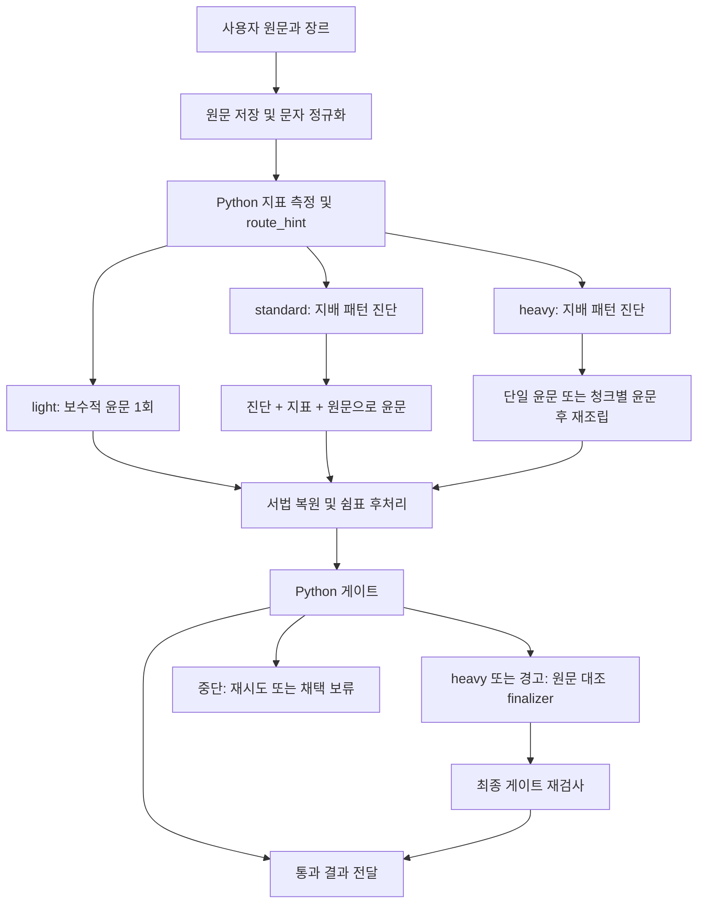

# im-not-ai 동작 원리 및 코드 전수 조사

조사일: 2026-09-08 · 대상: `C:\project\2026\im-not-ai`

분석 기준은 로컬 `main`의 **`9747f036cdc28a1a8aea4dc71fef1f7846eb96f7`**이다. 패키지 버전은 2.3.2이고 규칙 문서에는 이후의 v2.4~v2.7 변경 이력이 섞여 있다. 원본 저장소의 추적 파일을 수정하거나 원격과 동기화하지 않았다.

## 1. 결론

**이 프로젝트의 본체는 한국어 편집 규칙집과, 그 규칙을 외부 LLM이 실행하도록 안내하는 작업 절차다.** Python은 문체 특징 측정, 경로 권고, 문서 분할, 일부 잘못된 편집 복원, 결과 검사를 맡는다. 문장을 이해하고 다시 쓰는 능력은 호스트 Claude·Codex·Gemini 등의 모델에서 온다.

이를 구성 요소로 쓰면 다음과 같다.

`한국어 편집 지식 + LLM 작업 지시 + 결정적 전·후처리 + 회귀 평가 자료`

현재 저장소에는 자체 추론 모델 가중치, 모델 학습 루프, 상시 실행 서버, 데스크톱 앱이 없다. `corruption_engine.py`는 향후 학습용 쌍을 만드는 도구이며, 학습된 윤문 모델 자체는 아니다. 웹 서비스 파일도 구현 코드가 아니라 설계 문서다.

가장 가치 있는 자산은 한국어의 반복적인 번역투를 문맥·장르에 맞춰 다루는 규칙, 진단과 편집을 분리한 흐름, 모델의 실수를 코드로 되돌리는 후처리다. 다만 **“내용 100% 보존”은 설계 목표이며 코드가 증명하는 보장은 아니다.** 실제 재현에서 수치의 대상 교환, 긍정·부정 반전, 짧은 인용 변경이 게이트를 통과했다.

## 2. 조사 범위와 증거

| 항목 | 범위 |
|---|---:|
| Git 추적 파일 | 119개 |
| 텍스트 파일 | 116개, 물리적 줄 수 22,017줄 |
| Python | 46개: scripts 18개 + 지표 2개 + tests 26개 |
| 에이전트 정의 | 9개 |
| 이미지 | 3개, 배포용 social preview |
| 분류표에 쓰인 패턴 헤딩 | 85개 |
| 빌더가 인식하는 패턴 | 84개 |
| 윤문용 quick 규칙 | 61개 |
| quick에서 제외한 진단용 항목 | 23개 |

전 파일의 목록·크기·해시를 수집하고 Python 전체를 AST로 파싱하여 함수·클래스·import를 조사했다. 런타임 및 빌드·평가 소스는 구현을 추적했고, 규칙 84개는 진단·처방 생성물과 대조했다. 문서의 과거 설계·현재 실행 계약·외부 연구 주장을 구분했다. 이미지 3개는 파일 형식과 크기 및 생성 스크립트 역할을 조사했으며 디자인 평가는 하지 않았다.

- [파일별 역할 및 전체 규칙 목록](files.md)
- [기계 판독용 전체 인벤토리](inventory.json): 해시, 함수 위치, docstring, import, 문서 헤딩 포함
- [재현 코드](probe.py)와 [재현 결과](probes.json)
- [원본 테스트 결과와 Windows 재확인](validation.json)

실제 LLM 윤문 품질의 새로운 대규모 실험은 이번 조사에 포함하지 않았다. 아래의 반례는 사람이 만든 입력·출력 쌍에 원본 Python 검증기를 실행한 결과이며, 모델이 그 잘못된 문장을 실제 생성했다는 뜻은 아니다.

## 3. 전체 실행 흐름



이 흐름의 분기·에이전트 호출·재시도는 Python 상태 머신 하나로 구현되어 있지 않다. **Claude용 SKILL.md가 호스트 에이전트에게 절차를 지시**하고, 호스트가 필요한 Python 스크립트와 하위 에이전트를 호출한다. 문서에 적힌 “1콜·2콜·3콜”은 주요 LLM 작업 단계 수다. 실제 API 요청 수와 토큰 총량은 도구 호출·컨텍스트 재로드·재시도에 따라 더 커진다. [실행 계약][skill]

### 3.1 입력 정리

호스트가 원문을 `_workspace/{run_id}/01_input.txt`에 쓴다. 장르 자동 추정은 모델이 첫 300자를 읽고 하는 작업이며 Python 분류기가 아니다. 챗봇의 앞뒤 안내 문장을 벗기라는 지시도 스킬 문서에 있고, `sanitize_text.py`의 기능은 아니다.

`prepare_monolith_input.py`는 스크립트 위치에서 규칙·지표 모듈을 찾고, 작업 데이터의 상대 경로는 호출자의 cwd에서 해석한다. 설치 경로와 사용자 작업 폴더를 분리한 설계다.

`sanitize_text.py`는 제로폭·방향 제어 문자·특수 공백을 정리하고 NFC 및 줄바꿈을 통일한다. 일부 이모지의 ZWJ 연결은 보존한다. 전각 공백과 연속 빈 줄 축약은 기본적으로 꺼져 있다. 정리가 발생하면 **run 디렉터리의 `01_input.txt` 자체를 갱신**하고 `00_sanitize.json`을 쓴다. 따라서 후속 diff의 기준은 붙여넣은 원본 바이트가 아니라 정규화된 텍스트다. 이 처리는 문체 재작성이나 통계적 워터마크 탐지가 아니다. [입력 shim][shim] · [문자 정리][sanitize]

### 3.2 지표를 모델에게 전달

`metrics_v2.compute_all()`은 v1 지표를 계산한 다음 v2 지표를 덧붙인다. 결과는 `00_metrics.json`에 기록되고 다음 순서의 결합 입력으로 바뀐다.

```text
[진단]                  # standard/heavy에서 있으면 포함
지배 패턴 ID · 근거 · 처방 · 보존 지침
[정량 사전 점수]
risk_band · route_hint · 지표 원값 · 일부 z 값
[원문 시작]
한국어 본문
[원문 끝]
```

숫자 세기를 모델에게 맡기지 않고, 모델은 그 수치와 규칙을 이용해 어느 문장을 어떻게 편집할지 판단한다. 모듈 import는 v2 → v1 → 점수 없는 입력 순으로 실패 시 기능을 줄인다. 단, 실패 시 남는 과거 JSON 문제는 §10에서 설명한다.

### 3.3 경로 선택의 실제 조건

`T`는 결산·균형 어휘 카운트, 이중 피동, by-passive, have/make 직역, 이중 조사, 일부 추가 패턴 정규식의 합이다. 단위는 중복 제거한 “문제 문장 수”가 아니라 여러 검출기의 히트 합이다.

| 우선순위 | 코드 조건 | 권고 경로 |
|---|---|---|
| 1 | 글자 수 > 15,000 | heavy |
| 2 | risk=high이고 T ≥ 8 | heavy |
| 3 | T ≤ 2이고 risk가 low 또는 medium | light |
| 4 | 나머지 또는 위험도 불명 | standard |

사용자 명시가 우선한다. 스킬은 정밀 요청을 heavy, 가볍게 요청을 light로 처리한다. 경로 힌트가 없으면 standard다. 단순히 T가 많다는 이유만으로 짧은 글이 heavy가 되지는 않는다. [compute_route_hint][route]

## 4. 지표는 무엇을 재는가

### 4.1 v1: 8개 기본 지표

| 지표 | 계산 방식 | 주의점 |
|---|---|---|
| comma_inclusion_rate | 쉼표가 있는 문장 수 / 문장 수 | 문장 분리는 정규식 |
| comma_usage_rate | 쉼표 수 / 문장 수 | 숫자 내부 쉼표도 표층 집계에 영향 가능 |
| ending_comma_rate | 특정 연결어미 뒤 쉼표 / 해당 어미 후보 | 형태소 분석이 아닌 음절·경계 근사 |
| comma_segment_length | 쉼표로 나눈 구간의 평균 어절 수 | 실제 통사절 길이는 아님 |
| conclusion_pivot_count | 결론적으로·따라서·이를 통해·그러므로 횟수 | 의미상 필요한 접속인지 판단하지 않음 |
| safe_balance_count | 양쪽 모두·신중하게·균형 등 횟수 | 정상 문장에서도 검출 |
| hanja_nominalizer_density | 어절 끝 성·적·화 비율 | 조사 결합과 동형 단어에 취약 |
| lexical_diversity | 서로 다른 어절 / 전체 어절, TTR | 글 길이와 조사 변화에 민감 |

`z`라는 이름을 쓰지만 v1은 실제 사람 표본의 표준편차를 쓰지 않는다.

```text
sigma_proxy = abs(AI 평균 - 사람 평균) / 2
z_proxy = (측정값 - 사람 평균) / sigma_proxy
```

사람·AI 평균이 같으면 0을 반환한다. 한자어 밀도와 TTR에는 코드에 적힌 가정값이 쓰인다. 따라서 z=2를 정규분포에서의 유의성이나 AI 작성 확률로 해석하면 안 된다. [v1 지표 및 점수][metrics1]

위험도는 문장부호 계열 최대 3점, 어휘 계열 최대 2점, 수사 어휘 계열 최대 2점의 합이다. 6점 이상이며 2개 이상 계열이 발화하면 high, 그 외 4점 이상이면 medium이다. 문장부호 한 계열만으로 high가 되지 않도록 보정되어 있다.

### 4.2 v2: 14개 지표와 추가 대구 카운트

14개 지표는 TTR, 어휘 밀도, 종결 다양성, 평서형 집중, '-다' 연속 구간, 무생물 주어, by-passive, 이중 피동, 대명사 밀도, '-들' 비율, 관형절 중첩, have/make 직역, 이중 조사, 진행형 비율이다. 여기에 C-8 대구 카운트가 추가되어 **`v2_metrics` 필드는 현재 15개**다. 별도로 여러 특징을 정규화·상한 처리해 더하는 `v2_interference_index`도 반환한다. [v2 구현][metrics2]

이름이 언어학 용어여도 측정 방식은 대부분 작은 어휘 사전과 정규식이다. 예를 들어 관형절 “중첩”은 실제 구문 트리 깊이가 아니라 한 문장에 특정 관형형 어미 후보가 3회 이상 나오는지를 센다. `ending_diversity`는 entropy가 아니라 문장 끝 한두 음절의 unique/total이다. MeCab·KoNLPy·신경망 형태소 분석은 런타임에 없다.

`baseline_v2.json`의 5장르 × 14셀은 모두 `_placeholder: true`다. **경고를 남기면서도 수치 z를 계산해 JSON에 넣는다.** 결합 프롬프트는 이 v2 z를 숨기고 일부 원값만 보여준다. `risk_band`는 v1 결과를 유지하므로 v2 composite가 위험도 분류기를 직접 교체하지 않는다.

## 5. 규칙집과 실제 윤문 방식

### 5.1 규칙의 구성

| 범주 | 빌더 인식 수 | 처리하는 현상 |
|---|---:|---|
| A | 24 | 번역투, 조사, 피동, 대명사, 추상 서술 |
| B | 4 | 불필요한 영어 병기·장식 |
| C | 12 | 열거·헤딩·대구·쉼표 등 문서 구조 |
| D | 14 | 상투적 결론·과장·은유·공식적 문장 |
| E | 7 | 문장 길이·종결·격식 일관성 |
| F | 6 | 수식 중복·명사화·범용 동사 |
| G | 3 | 완곡 표현 중첩과 반복 |
| H | 4 | 접속사·지시 표현 반복 |
| I | 7 | 형식명사·권고 결말·무주체 평가 |
| J | 3 | 따옴표·대시·괄호 |

문서에는 J-1 볼드 규칙도 있지만 잘못된 헤딩 깊이 때문에 위 집계와 생성물에서 빠진다. 따라서 **문서 85개 / 파싱 84개 / quick 61개**를 구분해야 한다. A-17은 관찰용 hold이고, G-3도 실증 부족 hold라는 경고가 있지만 quick에 남아 있다. 단순히 “84개 모두 검증된 AI 판별 규칙”이라고 말할 수 없다.

### 5.2 두 가지 규칙 생성물

`ai-tell-taxonomy.md`가 원본이다. `build_quick_rules.py`는 패턴 헤딩과 `_quick: true/false · quick_pattern · quick_fix` 메타를 읽고, true 항목에 고정 header/footer를 붙여 윤문용 `quick-rules.md`를 만든다. `build_diagnosis_rules.py`는 같은 파서를 재사용해 전체 패턴의 ID·짧은 정의·시그니처를 만든다. 두 빌더의 `--check`는 파일을 재생성했을 때 현재 생성물과 같은지 검사한다. [quick 빌더][quick-builder] · [진단 빌더][diag-builder]

이 방식은 사람이 두 문서를 따로 수정하며 ID가 어긋나는 일을 줄인다. 다만 **양쪽 빌더가 같은 잘못된 파서를 공유하면 누락도 함께 공유**한다. 이번 J-1 누락이 그 사례다.

### 5.3 모델이 하는 판단

진단 에이전트는 전체 문서에서 지배적인 패턴 3~6개와 근거·처방을 고른다. 모든 span을 다 나열하기보다 다음 편집 모델이 집중할 대상을 정한다. 윤문 에이전트는 원문과 quick 규칙을 읽고, 핵심 명사·개념어를 내부 `anchor_ledger`로 기억한 후 D → A → I → G → H → F → B → C·J → E 순으로 편집하도록 지시받는다. [진단][diagnostician] · [윤문][monolith]

`anchor_ledger`는 저장·검사되는 Python 자료구조가 아니다. 해당 이름의 메모리 목록을 만들라는 **프롬프트상의 계약**이다. 대부분의 finding·변경 등급·S1 잔존 수치도 모델 자가 보고다.

대표적인 편집 의도는 다음과 같다. 아래는 규칙을 설명하는 예시이며 이번 조사에서 LLM이 생성한 결과는 아니다.

| 원문 형태 | 편집 의도 |
|---|---|
| 강한 경쟁력을 가지고 있다 | 경쟁력이 강하다: 가벼운 동사를 덜어내기 |
| 판단되어진다 | 판단된다: 중첩 피동 줄이기 |
| 동일한 추측 표현이 반복됨 | 유보 강도는 유지하면서 표현만 분산 |
| 문단마다 “A가 아니라 B” | 필요성이 약한 반복 일부를 비대칭 문장으로 |
| 같은 명사를 계속 대명사로 받음 | 직전 2문장 선행 명사구 후보를 확인해 생략·복원 판단 |

반복 규칙을 일반 금지어 목록처럼 적용하면 사람의 문체도 훼손된다. 최신 A-16은 대명사 빈도 대신 문맥상 선행 후보 수를 쓰고, A-1·A-2·H-1·H-3는 반복이 밀집했을 때 일부만 바꾸도록 보수화되어 있다.

## 6. 후처리와 검증의 정확한 범위

### 6.1 서법 복원

`restore_modality.py`는 원문과 윤문본을 문장으로 나눈 뒤 **문자 바이그램 Dice 유사도 + Needleman–Wunsch 정렬**로 짝을 찾는다. 당위·추측 정규식이 원문 문장에 있고 대응 문장에서 사라졌으면 손실 후보다. 유사도 0.35 미만, 결과에서 문장을 유일하게 특정할 수 없음, 병합·분할 의심 등은 자동 복원을 보류한다. 확실한 경우 원문 문장을 복원하되 이미 제거한 일부 상투구는 다시 붙이지 않는다. [서법 복원][restore]

재현: `성장률은 낮은 것으로 판단된다.` → `성장률은 낮은 수치다.`라는 후보를 넣자 원문 문장으로 1건 복원했다. 이 알고리즘은 일반 의미 동치 검사가 아니라 지정된 서법 표지의 소실을 잡는 장치다. 긍정·부정 반전, 원래 없던 서법의 주입, 삭제되어 대응 문장이 없는 경우를 모두 막지는 않는다.

### 6.2 새로 만든 쉼표 제거

`strip_injected_commas.py`는 원문에 공백 정규화 후 그대로 존재하는 문장을 보존한다. 새로 작성된 문장에서 특정 연결어미 뒤 쉼표를 제거하고 따옴표 범위를 피한다. `--all`은 원문과 같은 문장에도 적용하지만, standard/heavy의 진단에서 C-11을 지목했을 때만 쓰라는 제한은 **호스트에 대한 지시**다. 스크립트 자체가 route나 diagnosis를 받아 자격을 검증하지는 않는다. [쉼표 후처리][commas]

### 6.3 게이트

| 축 | 검사 | 결과에 미치는 영향 |
|---|---|---|
| P0 | 문자 변경률 | ≥30% 경고, ≥50% 중단 |
| P1 | 원문 z>2였던 일부 지표의 수렴 | 미달·과교정 시 경고 |
| P2 | 원문 대구 ≥5인데 결과 0 | 전멸 경고 |
| P3 | 알려진 격식·상투구·제목·각주·인용·수치 주입 문제 | 발견 시 경고 |
| P4 | 문장 터치율, 사라진 숫자 값 | 보고만, exit에 미반영 |
| P5 | 정렬된 문장쌍의 당위·추측 소실 | 확신 가능한 손실에 경고 |

코드는 “5축 + 보고”라고 표현한다. P0~P5 여섯 항목 중 P4가 판정에 참여하지 않기 때문이다. 과거 문서에는 4축 설명도 남아 있다.

최종 exit는 0=통과, 1=경고, 2=중단, 3=실행 오류다. P3의 `FAIL`도 통합 exit는 1일 수 있다. 게이트 자체는 결과 채택을 물리적으로 막지 않고 종료 코드로 알린다. 채택 금지·재시도·finalizer 승급은 호스트 절차가 집행한다. [통합 게이트][gates] · [세부 검사][checks]

변경률의 실제 공식은 **`1 - SequenceMatcher(..., autojunk=False).ratio()`**다. 레벤슈타인 거리도, 의미 변화량도 아니다. 문자 몇 개로 의미를 뒤집으면 수치가 작게 나온다. P1도 전체 84개 패턴의 개선이나 진단문에 나오는 패턴 제거를 검증하지 않는다. 주로 v1 쉼표·한자어 지표의 proxy z를 본다.

### 6.4 finalizer

원문·윤문본·선택적 진단문을 읽고 의미 15항과 자연성을 대조한다. 전체를 다시 쓰지 않고 문제 구간만 고치며 `accept/corrected/hold_and_report`를 기록하도록 지시한다. 이 단계가 숫자·정규식 검사를 넘어선 의미 판단을 보완하지만, 동일 계열 LLM의 확률적 검토이므로 완전한 보증은 아니다. [마무리 에이전트][finalizer]

## 7. 장문 처리는 어떻게 하는가

청킹은 원문 문자열의 `[start, end)` 범위를 만든다. 헤딩 앞, 문단 경계, 긴 문단 내부 문장 경계를 이용해 묶고, 말미 각주 블록은 passthrough로 뺀다. 기본 목표 7,000자, 상한 표기 9,000자지만 쪼갤 수 없는 구간은 경고와 함께 초과할 수 있다. 10,000자 무구두점 문장을 넣었을 때 실제로 10,000자 청크 하나가 나왔다. [분할 코드][chunk]

manifest에는 전체 원문 SHA-256과 각 청크 범위·입출력 파일명이 들어간다. 재조립기는 원문 해시와 범위 연결을 검증하고, 빠진 출력·빈 출력을 거부한다. 각주 passthrough는 원문에서 가져오며 청크 가장자리 공백도 원문에서 복원한다. 길이비 <0.5 또는 >2는 경고이고 `--strict`일 때 오류다. 이미 결과 파일을 쓴 뒤 그 오류를 반환한다. 이 `--strict`는 스킬의 heavy 강제 옵션과 별개의 재조립 CLI 옵션이다. [재조립][reassemble]

청킹은 파일 분할 기능이지 문서 전체 의미 검증 기능이 아니다. 청크 간 문맥과 지시 대상, 문장 연결부는 모델·finalizer에 의존한다. 문서에서 주장하는 610K 대 134K 토큰은 특정 과거 실행의 보고치다. 이번 조사에서는 그 토큰 사용량과 품질 동등성을 새로 검증하지 않았다.

## 8. 실행 호스트와 배포 방식의 차이

| 배포 경로 | 현재 저장소의 실행 계약 |
|---|---|
| Claude Code | 스킬 3개 + agents 정의, Python shim·게이트를 호출하는 3경로 오케스트레이션 |
| Codex | `codex/skills/humanize-korean/SKILL.md`의 단일 호출 편집·자가검증 |
| GitHub Copilot CLI | 루트 plugin.json이 Codex와 같은 단일 호출 스킬 노출 |
| Gemini CLI | GEMINI.md 내장 규칙 + TOML 명령 3개, 단일 호출 |

**원본 Codex 포트는 Claude의 전체 Python 파이프라인과 동일하지 않다.** Codex 스킬 본문에는 shim·통합 게이트·복원기를 순서대로 호출하는 절차가 없다. 이는 Codex 제품의 능력 제한에 대한 주장이 아니라 이 저장소 포트의 구현 범위다. [Codex 포트][codex-skill]

Gemini는 별도 버전 1.5.0을 유지하는 독립 내장 규칙 배포물이다. `RELEASING.md`도 별개 트랙이라고 설명한다. 다만 오래된 “완곡 → 단언” 처방이나 과거 ID 대응이 남아 있어 최신 한국어 quick 규칙과 의미 정책이 다르다.

`install.sh`는 CLI 또는 홈 폴더를 감지하고 기본적으로 심볼릭 링크를 만든다. Claude 에이전트는 런타임 3개 + 유지보수 1개를 설치하며 `--all-agents`일 때 개발용 5개까지 설치한다. `--copy`는 복사 모드, `--force`는 기존 대상 백업 후 적용이다. `update.sh`는 추적 원격을 fetch하고 fast-forward만 pull한 뒤 설치 스크립트를 재실행한다. 사용자 서비스로 vendor를 이식하는 기능은 원본 `update.sh`에 없다.

## 9. 연구·데이터·테스트 도구의 역할

### 9.1 문체 규칙의 근거

프로젝트는 번역학의 간섭·단순화·정규화 개념을 한국어 윤문에 적용한다. KatFishNet 연구는 한국어 텍스트에서 띄어쓰기·품사 다양성·쉼표의 차이를 측정하고 별도의 탐지기를 제시한다. **im-not-ai가 그 학습된 탐지기를 탑재한 것은 아니다.** 논문을 참조해 가벼운 정규식 지표를 만든 것이다. [KatFishNet 원문 소개](https://aclanthology.org/2025.acl-long.1030/)

Toral의 post-editese 연구는 기계번역 후편집과 인간 번역의 단순화·정규화·간섭을 비교한다. 이 결과를 “모든 한국어 AI 문장의 원인이 증명됐다”로 확대할 수 없다. [Toral 2019](https://aclanthology.org/W19-6627/)

`scholarship.md`의 영어 중심 내부 표상 설명은 저자들이 여러 논문을 연결한 가설임을 명시한다. 실제 Wendler 연구는 Llama-2에서 특정 비영어 과제를 분석했고, Li 등의 연구는 지도학습 데이터와 번역투의 관계를 다룬다. 이들이 현재 모든 상용 모델의 한국어 문체에 동일한 인과 사슬을 입증한 것은 아니다. [Wendler et al.](https://arxiv.org/abs/2402.10588) · [Li et al.](https://arxiv.org/abs/2503.04369)

저장소 자체 측정 자료에는 24쌍 대조, 사람 60편 대 AI 60편, 과업을 맞춘 AI 39편 통계가 들어 있다. 원문 코퍼스와 일부 재현 도구는 별도 imnotai-web 저장소에 있다고 명시한다. 이번 분석 폴더만으로 코퍼스의 출처·모든 배수·실제 탐지 정확도를 독립 재산출할 수 없다. 특히 표본에서 0회 관찰했다고 실제 오탐률이 0%라는 뜻은 아니다.

### 9.2 학습쌍 생성 도구

`corruption_engine.py`는 정상 문장에 규칙을 역적용해 `corrupted → clean` 쌍을 만든다. 주입기 13개를 무작위 순서로 적용하고, 검출 수가 늘며 `checks.run_checks`가 통과할 때만 채택한다. 기본 seed=7, 문서당 변주 2개, no-op 확률 0.2, 최대 태그 3개다. 모델 훈련은 수행하지 않는다. [오염 엔진][corruption]

의미 중립은 완전히 증명되지 않는다. “심해졌다”를 “심화되고 있다”로 바꾸는 주입은 완료·진행 관점을 바꾸지만 현재 checks에는 잡히지 않는다. “따라서”, “과제도 남아 있다”의 삽입도 문맥에 따라 논리·주장을 더한다. 이 쌍을 학습 데이터로 쓰려면 문맥·시제·서법 검증을 별도로 해야 한다.

### 9.3 평가 도구

`eval_baseline.py`는 fixture × 모델 × 반복 횟수로 Claude CLI를 호출해 결과·변경률·보호 토큰·문체 지표를 저장한다. `eval_compare.py`는 두 평균 차이를 `sqrt((sdA²+sdB²)/2)`와 비교한다. 기본 2배를 넘어야 변화로 표시하지만 통계적 가설검정은 아니다. 실패 횟수도 별도로 봐야 한다. 스냅샷 생성 명령은 개별 실패가 있어도 마지막에 0을 반환한다.

테스트는 순수 함수, 저장된 입력·출력 쌍, 실제 Claude 호출로 나뉜다. 다만 live runner는 “파일을 만들지 마”라고 지시하고 구형 Fast/5인 표현을 사용하며, 실제로 shim·게이트·하위 에이전트를 호출했는지 trace를 검증하지 않는다. **live 테스트 통과도 전체 배포 파이프라인을 통과했다는 증거와 같지 않다.** [평가 러너][runner]

CI는 Ubuntu Python 3.11/3.12에서 pytest, 두 생성물 검사, Bash 설치 플래그 테스트를 실행한다. 실제 호스트 인증이 없는 CI에서는 live가 빠진다. 런타임 Python은 표준 라이브러리 위주이고, 이미지 생성 도구 3개는 Pillow와 로컬 macOS 폰트 경로를 요구한다. “저장소 전체가 무의존성”이라고 일반화하면 안 된다.

## 10. 재현한 결함과 제한

다음은 원본을 수정하지 않고 얻은 결과다. 세부 입력·출력·게이트 로그는 [probes.json](probes.json)에 있다.

| 번호 | 발견 | 직접 관측한 결과 | 구분 |
|---|---|---|---|
| R1 | J-1 규칙 누락 | `## J-1.`은 파서의 `###` 계약 밖. 문서 85개 중 84개만 생성, 두 `--check`는 통과 | 빌드 결함 |
| R2 | 숫자와 대상의 연결 미검증 | 서울 10·부산 20 → 서울 20·부산 10, 변경률 10%, exit 0 | 의미 보존 공백 |
| R3 | 숫자 소실은 보고만 | “20명” → “여러 명”, 변경률 7.69%, dropped=['20'], exit 0 | 명시적 원본 정책 |
| R4 | 부정 반전 미검증 | “이 제품은 안전하다” → “안전하지 않다”, 변경률 12%, exit 0 | 의미 보존 공백 |
| R5 | 짧은 직접 인용 미보호 | “승인한다” → “거절한다”, 변경률 13.33%, exit 0 | `MIN_QUOTE_LEN=8` 제한 |
| R6 | 카운트 중복 | “보여진다.” 한 표현을 이중 피동 4건으로 집계 | 사전 부분 문자열 중첩 |
| R7 | 일반·청크 경로 불일치 | 같은 48자 입력: 일반 standard, --chunk light | 청크 모드 `_text` 전달 누락 |
| R8 | 실패 후 과거 JSON 잔존 | 성공 후 지표 오류 주입: 점수 없는 새 입력 + error + 과거 metrics JSON 공존 | 오래된 경로 권고 오독 위험 |
| R9 | 평가 지표 4종 미측정 | double_passive/by_passive/have_make/double_particle가 전부 null | 평가 헬퍼가 v1만 조회 |
| R10 | 평가 변경률과 운영 변경률 불일치 | 900자 반복문 앞에 짧은 문구 삽입: 운영 0.22%, 평가 100% | 평가의 autojunk 기본값 |
| R11 | 청크별 메타데이터 충돌 | 각 청크 끝에 summary를 붙인 모의 응답 재조립 시 게이트가 첫 청크 이후를 제거 | 출력 계약의 조건부 결함 |
| R12 | placeholder가 숫자로 노출 | v2 14개 placeholder 경고와 동시에 14개 숫자 z 반환 | 소비자 해석 위험 |

R11은 실제 모델 발생률을 측정한 것이 아니다. monolith의 “본문 뒤 summary” 계약을 청크에도 적용했을 때의 재현이다. 재조립기는 summary를 제거하지 않고, 게이트는 첫 summary 시작부터 파일 끝을 버린다. 청크 결과를 본문 전용으로 강제하거나 메타데이터를 별도 파일로 분리해야 이 조합을 막을 수 있다.

추가 정적 발견:

- `/humanize-redo`는 이미 은퇴한 `korean-style-rewriter`, `content-fidelity-auditor`와 `02_detection.json` 등을 참조한다. 최신 메인 스킬의 heavy 재실행 설명과 맞지 않는다.
- `rewriting-playbook.md`의 레벤슈타인 설명, 영문 integration의 바이그램 변경률 설명, 실제 문자 SequenceMatcher 구현이 서로 다르다. 바이그램은 서법 문장 정렬에는 실제 사용되지만 현재 변경률 공식은 아니다.
- finalizer의 4회 도구 호출 상한은 3개 파일 Read + 2개 파일 Write + 백업을 일반적인 파일별 도구로 수행할 때 맞지 않는다. 여러 파일을 한 호출로 쓰는 별도 도구 가정이 필요하다.
- 진단 인덱스는 정의 38자·시그니처 42자·S1 예문 28자로 자른다. A-16처럼 조건이 긴 규칙은 일부 조건이 잘린다. 빠른 전달과 조건 보존 사이의 절충이다.
- quoting, 문장 분리, 헤딩·각주 탐지가 모듈별로 다르다. 예를 들어 checks는 50자 초과 헤딩을 제외하고 일부 각주 표기만 처리한다. 모든 Markdown 문서를 구조적으로 해석하는 파서는 아니다.
- source hash는 낡은 원문을 검출하지만 모든 manifest 필드의 스키마·경로 안전성을 검증하는 것은 아니다. 원본 도구는 신뢰된 로컬 작업 폴더를 전제한다.

### 테스트 실측

환경은 Windows, Python 3.14.7, 별도 임시 경로에 설치한 pytest 9.1.1이다.

| 검사 | 결과 |
|---|---|
| 원본 offline pytest 전체, live 파일 제외 | **278 passed / 3 failed / 1 skipped**, 별도 subtests 74 passed |
| quick-rules 생성 일치 | 통과, true 61 / false 23 |
| diagnosis-rules 생성 일치 | 통과, 84개 |
| Bash 설치 플래그 테스트 | 통과, 격리된 임시 홈 사용 |
| 원본 추적 파일 변경 | 없음 |

실패 3건 중 2건은 Bash 경로 유도 테스트다. 처음에는 PATH에 Bash가 없었고, Git Bash를 추가해 재실행하자 Bash가 반환한 `/c/...`를 Windows `Path`가 잘못 해석하는 테스트 비교 문제로 남았다. 이는 곧바로 shim 계산 로직의 실패를 뜻하지 않는다.

나머지 1건은 Codex/Copilot references 링크다. Git에는 심볼릭 링크(mode 120000)로 기록되어 있지만 이 checkout은 `core.symlinks=false`라 42바이트 일반 파일이다. 따라서 `references/quick-rules.md`가 존재하지 않는 것으로 검사된다. 이 로컬 checkout에서 원본 Codex 포트를 그대로 사용하는 데 실제 제약이 있다. 우리 서비스의 실파일 vendor 번들과는 별개다.

skip 1건은 저장소에 없는 과거 실측 run을 요구하는 테스트다. live 테스트 파일은 명시적으로 제외했으며 실제 윤문 품질 실험의 미실행을 “통과”에 포함하지 않았다. JUnit의 tests=356에는 subtest 74개가 포함되므로 278+74+3+1로 읽어야 한다.

## 11. 우리 서비스와의 관계

우리 서비스의 `vendor/humanize-engine/UPSTREAM.md`도 동일한 `9747f03`을 가리킨다. 원본과 완전히 같은 파일을 무조건 실행하는 것은 아니고 별도 portal patch와 `engine_runtime` 정책을 더한다.

이미 보강한 부분:

- vendor를 실파일로 포함하여 옆 원본 저장소나 Codex references 심볼릭 링크에 의존하지 않는다.
- portal patch는 청크 경로에 원문을 전달해 R7을 보정하고 LF/CRLF 보존 및 짧은 글 경로를 처리한다.
- `engine_runtime/workflow.py`는 숫자 소실을 `number_dropped` hard failure로 승격한다. 제목·각주·검출된 인용·수치 주입 실패도 중단 쪽으로 처리한다. 원본의 R3 정책보다 강하다.
- `skill_gateway.py`는 source·manifest·개별 source chunk hash, leaf 경로, 상태·시도 횟수를 검사한다. 스킬용 응답은 `rewrittenText`와 `warnings` 구조로 받는다.

그러나 **원본 checks의 숫자 집합 방식과 짧은 인용 제한을 그대로 사용하므로 R2·R5를 자동으로 해결한 것은 아니다.** 부정 반전 같은 R4도 현재의 Python 검사만으로 보장할 수 없다. 이번 조사는 서비스 전체를 새로 품질 검증한 것이 아니라 이 연결부 소스를 확인한 것이다. [우리 검증 정책](../../../engine_runtime/workflow.py) · [우리 스킬 Gateway](../../../engine_runtime/skill_gateway.py) · [vendor 출처](../../../vendor/humanize-engine/UPSTREAM.md)

## 12. 후속 구현 우선순위

1. **의미 보존 강화**: 수치의 값뿐 아니라 대상·단위·부호·반복 횟수를 문장쌍으로 비교하고, 짧은 발화 인용·부정/조건/서법 변화를 별도 검사한다. 자동 판정이 불확실하면 추가 검토나 해당 문장 복원으로 처리한다.
2. **규칙 빌드 계약 정비**: J-1을 포함한 모든 헤딩을 독립 스캐너로 대조한다. 정규식 파서가 스스로 센 목록과만 비교하지 않는다. 패턴 수·상태·severity·버전을 기계 데이터로 관리하고 출력물은 생성한다.
3. **평가 도구 정비**: 운영과 평가의 change_rate 함수를 공유하고 v2 신호를 실제 호출한다. 지표 null·불러오기 실패·LLM 실행 실패는 “측정 실패”로 명시한다.
4. **문서와 호스트 계약 정리**: redo의 은퇴 에이전트 참조, Gemini 구형 처방, 변경률 설명, 도구 호출 예산을 현재 구현으로 맞춘다. 호스트별 동일 fixture와 trace를 검사한다.
5. **실사용 품질 측정**: 사람 원문 보존 세트, AI 초안 개선 세트, 학술·보고서 구조 세트, 긴 문서 세트를 나누고 여러 번 실행한다. 수정량 자체보다 의미 손실·과교정·잔존 문제·비용을 함께 비교한다.

이 목록은 이번 코드 조사에서 도출한 후속 작업이다. 원본이나 서비스 엔진에 해당 수정을 적용한 상태는 아니다.

## 재현 방법

```powershell
$env:PYTHONUTF8='1'
$env:PYTHONDONTWRITEBYTECODE='1'
python docs/research/im-not-ai-2026-09-08/probe.py `
  --source C:/project/2026/im-not-ai `
  --work C:/project/2026/ai-text-makes-likes-human/runtime/test-tmp/research-im-not-ai/probes
```

probe는 source를 읽고, 지정한 work 아래에 실험 입력·출력을 만들며 보고서 옆 inventory/probes JSON을 재생성한다. 일부 probe는 결함을 보여주기 위해 오류를 의도적으로 주입하거나 잘못된 후보 출력을 제공한다. pass/fail 단위 테스트가 아니라 현 동작 관측 도구다.

테스트 의존성과 scratch 증거는 Git에서 제외되는 `runtime/test-tmp/research-im-not-ai/`에 보관했다. validation.json의 임시 경로는 테스트 당시 실제 경로이며 정리 후 현재 보관 경로와 다를 수 있다.

[skill]: https://github.com/epoko77-ai/im-not-ai/blob/9747f036cdc28a1a8aea4dc71fef1f7846eb96f7/skills/humanize-korean/SKILL.md
[shim]: https://github.com/epoko77-ai/im-not-ai/blob/9747f036cdc28a1a8aea4dc71fef1f7846eb96f7/scripts/prepare_monolith_input.py
[route]: https://github.com/epoko77-ai/im-not-ai/blob/9747f036cdc28a1a8aea4dc71fef1f7846eb96f7/scripts/prepare_monolith_input.py#L240
[sanitize]: https://github.com/epoko77-ai/im-not-ai/blob/9747f036cdc28a1a8aea4dc71fef1f7846eb96f7/scripts/sanitize_text.py#L170
[metrics1]: https://github.com/epoko77-ai/im-not-ai/blob/9747f036cdc28a1a8aea4dc71fef1f7846eb96f7/skills/humanize-korean/references/metrics.py#L243
[metrics2]: https://github.com/epoko77-ai/im-not-ai/blob/9747f036cdc28a1a8aea4dc71fef1f7846eb96f7/skills/humanize-korean/references/metrics_v2.py
[quick-builder]: https://github.com/epoko77-ai/im-not-ai/blob/9747f036cdc28a1a8aea4dc71fef1f7846eb96f7/scripts/build_quick_rules.py#L61
[diag-builder]: https://github.com/epoko77-ai/im-not-ai/blob/9747f036cdc28a1a8aea4dc71fef1f7846eb96f7/scripts/build_diagnosis_rules.py#L116
[diagnostician]: https://github.com/epoko77-ai/im-not-ai/blob/9747f036cdc28a1a8aea4dc71fef1f7846eb96f7/agents/humanize-diagnostician.md
[monolith]: https://github.com/epoko77-ai/im-not-ai/blob/9747f036cdc28a1a8aea4dc71fef1f7846eb96f7/agents/humanize-monolith.md
[restore]: https://github.com/epoko77-ai/im-not-ai/blob/9747f036cdc28a1a8aea4dc71fef1f7846eb96f7/scripts/restore_modality.py#L96
[commas]: https://github.com/epoko77-ai/im-not-ai/blob/9747f036cdc28a1a8aea4dc71fef1f7846eb96f7/scripts/strip_injected_commas.py#L68
[gates]: https://github.com/epoko77-ai/im-not-ai/blob/9747f036cdc28a1a8aea4dc71fef1f7846eb96f7/scripts/verify_gates.py#L235
[checks]: https://github.com/epoko77-ai/im-not-ai/blob/9747f036cdc28a1a8aea4dc71fef1f7846eb96f7/scripts/checks.py
[finalizer]: https://github.com/epoko77-ai/im-not-ai/blob/9747f036cdc28a1a8aea4dc71fef1f7846eb96f7/agents/humanize-finalizer.md
[chunk]: https://github.com/epoko77-ai/im-not-ai/blob/9747f036cdc28a1a8aea4dc71fef1f7846eb96f7/scripts/prepare_monolith_input.py#L633
[reassemble]: https://github.com/epoko77-ai/im-not-ai/blob/9747f036cdc28a1a8aea4dc71fef1f7846eb96f7/scripts/reassemble_chunks.py
[codex-skill]: https://github.com/epoko77-ai/im-not-ai/blob/9747f036cdc28a1a8aea4dc71fef1f7846eb96f7/codex/skills/humanize-korean/SKILL.md
[corruption]: https://github.com/epoko77-ai/im-not-ai/blob/9747f036cdc28a1a8aea4dc71fef1f7846eb96f7/scripts/corruption_engine.py
[runner]: https://github.com/epoko77-ai/im-not-ai/blob/9747f036cdc28a1a8aea4dc71fef1f7846eb96f7/tests/humanize_runner.py
